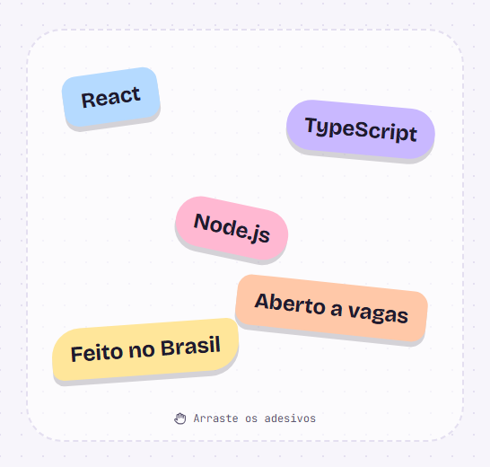
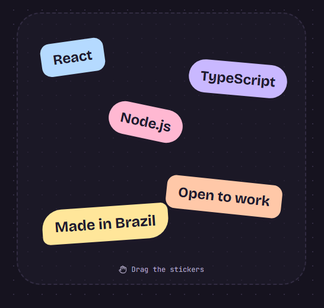

<div align="center">



# gustavo · rosa

**Portfólio de Gustavo Rosa de Sousa, desenvolvedor Full-Stack Júnior.**
Tons pastel, tema claro e escuro, português e inglês, e uma mesa de adesivos que dá para arrastar.


[LinkedIn](https://www.linkedin.com/in/gustavo-rosa-de-sousa/) · [E-mail](mailto:gustavorosadesousa11@gmail.com) · [GitHub](https://github.com/GustavoR1991)

</div>

---

## Sobre o projeto

Eu queria um portfólio que não parecesse mais um site preto com verde. Então montei um com cara de caderno: fundo de papel pontilhado, cores pastel e adesivos com as tecnologias que eu uso, que o visitante pode arrastar pela tela.

Os dados do GitHub (foto, número de repositórios, seguidores e a lista de projetos) vêm direto da API do GitHub. Assim, o site se atualiza sozinho quando eu publico algo novo.

## Prévia

| Tema claro | Tema escuro |
| :---: | :---: |
|  |  |

## Funcionalidades

- **Mesa de adesivos:** os adesivos entram com animação e podem ser arrastados, sem sair da mesa (Framer Motion).
- **Tema claro e escuro:** segue o tema do sistema na primeira visita e salva a escolha no navegador. Um script no `index.html` aplica o tema antes da página aparecer, para não piscar.
- **Português e inglês:** um botão PT/EN troca todos os textos na hora. O TypeScript garante que as duas línguas têm exatamente as mesmas chaves.
- **Projetos do GitHub:** todos os repositórios públicos, sem forks, com os destaques primeiro, descrições traduzidas e um botão "Mostrar todos".
- **Currículo completo:** experiência, formação, cursos e idiomas.
- **Responsivo e acessível:** menu próprio para celular, botões com `aria-label` e cores com bom contraste nos dois temas.

## Tecnologias

| Camada | Ferramentas |
| --- | --- |
| Interface | React 19, TypeScript, Vite |
| Estilo | Tailwind CSS v4 (com variáveis CSS para os temas) |
| Animação | Framer Motion |
| Ícones | Lucide React + SVGs próprios para GitHub e LinkedIn |
| Dados | Axios + API pública do GitHub |
| Fontes | Bricolage Grotesque e JetBrains Mono |

## Como rodar

Você precisa do [Node.js](https://nodejs.org/) 20 ou mais novo.

```bash
git clone https://github.com/GustavoR1991/portfolio.git
cd portfolio
npm install
npm run dev
```

Abra o endereço que aparecer no terminal (normalmente `http://localhost:5173`).

| Comando | O que faz |
| --- | --- |
| `npm run dev` | Sobe o servidor de desenvolvimento |
| `npm run build` | Checa os tipos e gera a versão final na pasta `dist` |
| `npm run preview` | Mostra a versão final localmente |
| `npm run lint` | Roda o ESLint |

## Estrutura de pastas

```text
src/
├── components/        # Uma pasta por seção (Hero, Projects, Skills...)
├── constants/
│   └── profile.ts     # Nome, links, e-mail e repositórios em destaque
├── context/           # ThemeContext e LanguageContext
├── i18n/
│   └── translation.ts # Todos os textos em português e inglês
├── services/
│   └── githubApi.ts   # Chamadas à API do GitHub
├── styles/
│   └── global.css     # Cores dos temas e classes reaproveitadas
├── types/
│   └── github.ts      # Tipos das respostas do GitHub
└── utils/
    └── pastel.ts      # Classes das cores pastel
```

## Como personalizar

| Quero mudar... | Arquivo |
| --- | --- |
| Links, e-mail ou usuário do GitHub | `src/constants/profile.ts` |
| Quais repositórios aparecem primeiro | `featuredRepos` em `src/constants/profile.ts` |
| Qualquer texto do site (nos dois idiomas) | `src/i18n/translation.ts` |
| As tecnologias da seção Skills | o array `groups` em `src/components/Skills/index.tsx` |
| Os adesivos da mesa | o array `stickers` em `src/components/Hero/index.tsx` |
| As cores | as variáveis no topo de `src/styles/global.css` |

## Paleta

| Cor | Hex | Uso |
| --- | --- | --- |
| Lilás | `#C9B8FF` | Destaques, botão de tema, contato |
| Pêssego | `#FFC8A8` | Marca-texto do nome, cartões |
| Manteiga | `#FFE69A` | Botão de idioma, cursos |
| Céu | `#B5DAFF` | Adesivos e cartões |
| Rosa | `#FFB8D2` | Adesivos e linha do tempo |
| Tinta | `#1F1B2E` | Texto (claro) e texto sobre os tons pastel |
| Noite | `#16131F` | Fundo do tema escuro |

## Contato

- **LinkedIn:** [gustavo-rosa-de-sousa](https://www.linkedin.com/in/gustavo-rosa-de-sousa/)
- **E-mail:** [gustavorosadesousa11@gmail.com](mailto:gustavorosadesousa11@gmail.com)
- **GitHub:** [@GustavoR1991](https://github.com/GustavoR1991)

---

<details>
<summary><strong>English</strong></summary>

Personal portfolio of **Gustavo Rosa de Sousa**, a Junior Full-Stack developer from São Paulo, Brazil.

It has pastel colors, light and dark themes, a Portuguese/English switch, and a board of draggable tech stickers. Profile data and repositories come live from the GitHub API.

Built with React 19, TypeScript, Vite, Tailwind CSS v4 and Framer Motion.

```bash
npm install
npm run dev
```

</details>
